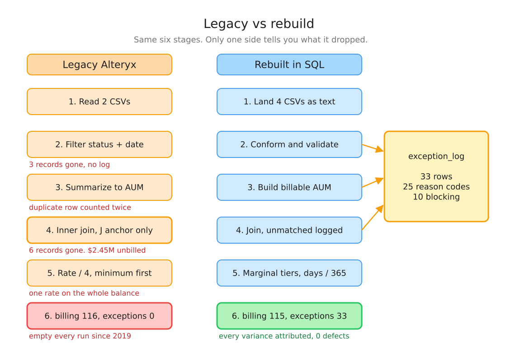
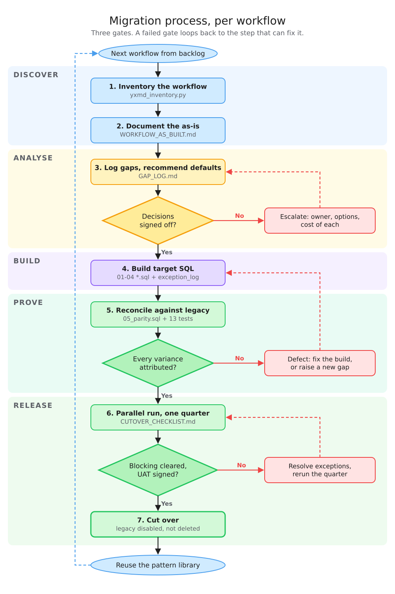

# Advisory Fee Billing: Alteryx → SQL Migration

A self-directed exercise in migrating an undocumented Alteryx workflow to SQL,
run the way a business analyst would run it: reverse-engineer the as-is logic,
surface the ambiguities and recommend resolutions, rebuild in SQL, and prove
parity account by account before cutover.

```bash
git clone <this repo> && cd fee-billing-migration-poc
./run_all.sh
```

No dependencies. Python 3.9+ and its standard library; the database is SQLite.

---



Editable source: [`docs/legacy_vs_rebuild.excalidraw`](docs/legacy_vs_rebuild.excalidraw)
(open at [excalidraw.com](https://excalidraw.com)). Regenerate with
`python3 tools/make_diagram.py`.

## Microsoft Fabric

The production target is in [`fabric/`](fabric/README.md): Lakehouse for files,
Warehouse for the logic, T-SQL stored procedures with a single transactional
entry point, and a pipeline design. It maps every one of the 13 Alteryx tools to
its replacement. Its logic is verified locally against this build, to the cent;
it has not yet been run in a Fabric tenant, and the Fabric README states exactly
what that leaves unproven.

## The result

The legacy workflow and the rebuilt pipeline were run on identical inputs and
reconciled account by account.

| | Legacy | Target |
|---|---|---|
| Accounts invoiced | 116 | 115 |
| Fees invoiced | $622,914.34 | $717,153.72 |
| Exceptions reported | **0** | 33 |
| Unexplained variances | n/a | **0** |

The target invoices **$94,239.38 more**, up 15.1%, and every dollar of that
difference traces to a specific decision:

| Cause | Accounts | Net effect |
|---|---|---|
| Marginal tiers replace one rate on the whole balance | 38 | $91,877.23 |
| Fee prorated to days actually held | 2 | −$28,707.85 |
| Closed account's final fee now raised | 1 | $28,247.14 |
| Household tiering applied as contracted | 25 | $19,259.31 |
| Priced on the account's own schedule, not Standard | 9 | −$8,114.20 |
| Unrecognised schedule code held for pricing | 1 | −$8,236.83 |
| Duplicate account row no longer double-bills | 1 | −$2,176.48 |
| Untrimmed join key — client had never been billed | 1 | $1,287.24 |
| Status outside the `ACTIVE` filter — revenue had stopped | 1 | $1,077.60 |
| Remaining day-count, duplicate-position and null-price effects | 36 | −$273.78 |

## Six defects the migration surfaced

Found by reading the workflow and reconciling its output, not by being told
about them.

1. **The exceptions report cannot populate.** The minimum-fee rule runs before
   the `billable_fee > 0` filter, so every row is forced to at least $250 and
   the filter excludes nothing. The report has been empty since 2019, and an
   empty exceptions report looks like a clean run.
2. **Tier pricing is not monotonic.** One rate was applied to a client's whole
   balance. At $999,999 the quarterly fee is $2,520; at $1,000,001 it falls to
   $1,890. A client who gains a dollar pays $630 less.
3. **A client holding $2.45M was never invoiced.** Their positions reference an
   account number absent from the account extract, and the inner join discarded
   them silently.
4. **Another client was never invoiced because of a trailing space.** Alteryx
   does not trim join keys. The account appears in both the left and right drop
   counts, so the record counts looked internally consistent.
5. **One account was billed twice.** A duplicated row in the account extract
   made the join fan out.
6. **An account holding nothing was invoiced $250, and an account that held
   $45.27M for 55 days was invoiced nothing.** Consequences of defects 1 and of
   a status filter that drops closed accounts.

## The process, per workflow



Every remaining workflow goes through the same loop. Each failed gate returns to the step that can fix it: an unsigned decision goes back to the gap log, an unexplained variance goes back to the build, and an uncleared blocking exception reruns the parallel quarter. Editable source: [`docs/migration_process.excalidraw`](docs/migration_process.excalidraw).

## A defect in my own first build, and how it was caught

The first version of the target SQL picked one price per ticker per account. When
an account held two lots of the same ticker on the same date, it kept one lot
and dropped the other with no record. That is the same kind of silent loss the
migration exists to remove. One account was billed on $771,204 instead of
$1,509,262.

The reconciliation did not catch it. That account also had a duplicated row in
the account extract, so its variance was attributed to that duplicate and looked
explained. It was caught when the logic was written a second time, in T-SQL for
Fabric. The two implementations disagreed on that one account, and the
disagreement led to the bug.

The fix keeps every lot on the price date and logs multiple lots as a review
exception, `E26`, because a second lot can also be a custodian restatement. A
test now rebuilds every account's AUM straight from the holdings file in plain
Python, so the fee test is no longer checking the SQL against its own output.

The lesson for the remaining workflows: attribution explains a variance, but it
does not prove the target is right. An independent recalculation does.

## How parity is proved

Matching totals prove nothing. The test is whether every account where the two
runs disagree can be attributed to a decision someone signed off.

`testing/05_parity.sql` full-outer-joins the two runs, classifies each account
as `MATCH`, `DIFFERS`, `LEGACY_ONLY` or `TARGET_ONLY`, and attributes every
variance to a numbered gap. Anything it cannot attribute lands in `v_defects`,
and a non-empty defect log blocks cutover.

`testing/test_fee_math.py` recalculates all 115 fees a second way, from an
independently typed copy of the published schedule, and asserts five invariants:
no fee on a non-positive balance, every unbilled account has a logged reason,
proration within the period, every effective rate inside its schedule's bands,
and zero unexplained variances. 14 tests, all passing.

## What changed in the rebuild

| | Legacy | Target |
|---|---|---|
| Tier application | One rate on the whole balance | Marginal bands |
| Rates | Hard-coded in a Formula tool | `ref_fee_schedule`, keyed by the account's own code |
| Household tiering | Never ran; a note says Operations does it in a spreadsheet | Aggregated where contracted, 16 households |
| Period accrual | Fixed divisor of 4 | Actual days held over 365 |
| Mid-period opens and closes | Billed a full quarter, or not at all | Prorated to the day |
| Excluded records | Discarded at five points, unlogged | 25 reason codes in `exception_log` |
| Join keys | Untrimmed, case-sensitive | Normalised on load, changes raised |
| Null prices | Silently contributed zero | Excluded and raised as blocking |
| Valuation date | Hard-coded literal, edited each quarter | Period parameter in `ref_billing_period` |

## Repository layout

```
legacy/
  FeeBilling_Quarterly_v7_FINAL.yxmd   the inherited workflow (XML)
  WORKFLOW_AS_BUILT.md                 tool-by-tool record of what it does
analysis/
  GAP_LOG.md                           20 gaps: options, recommendation, impact
fabric/
  README.md                            tool-by-tool mapping, deploy steps, pipeline
  sql/00-09_*.sql                      Fabric Warehouse T-SQL
target/
  01_schema.sql                        staging, dimensions, facts, exception log
  02_conform.sql                       key normalisation, validation, dedupe
  03_aum.sql                           positions to billable AUM
  04_fee_calc.sql                      marginal tiers, households, proration
  PORTING.md                           SQLite proof to Azure SQL / Fabric
testing/
  05_parity.sql                        reconciliation and defect log
  test_fee_math.py                     independent recalculation, 14 tests
delivery/
  STATUS.md                            one page: state, risks, decisions needed
  CUTOVER_CHECKLIST.md                 parallel run and go-live gates
  ROADMAP.md                           sequencing the remaining ~30 workflows
  workflow_backlog.csv                 inventory output, scored
tools/
  generate_data.py                     source extracts (seeded, reproducible)
  run_legacy_workflow.py               reproduces the Alteryx run, no licence
  build_target.py                      loads, builds, reconciles, exports
  yxmd_inventory.py                    parses .yxmd into an inventory + risks
  verify_fabric_sql.py                 runs the Fabric T-SQL locally, compares
  compare_fabric_output.py             checks a real Fabric export, account by account
data/
  input/            accounts, households, holdings, fee schedule
  legacy_output/    the baseline to reconcile against
  target_output/    billing, exceptions, parity, defects
CASE_STUDY.md                          the write-up
```

## The inventory tool

A `.yxmd` is plain XML, so the estate can be measured instead of estimated.
`tools/yxmd_inventory.py` reports every tool and its configuration, every
formula expression, file dependencies, and a complexity score for sequencing
migration waves. It also detects the failure modes that cause parity breaks:

```
MIGRATION RISKS AUTO-DETECTED (6)
  ! Tool 2 (Input Data): IgnoreErrors=True -- bad rows are silently coerced or dropped
  ! Tool 3 (Filter): hard-coded date literal 2026-09-30 -- edited by hand each run
  ! Tool 7 (Formula): 7 numeric literals in 'annual_rate_bps' -- business rates
    hard-coded in the workflow rather than a reference table
  ! Tool 6 (Join): Left, Right anchor(s) unconnected -- unmatched records are
    discarded with no audit trail
  ! Tool 3 (Filter): False anchor unconnected -- excluded records are not reported
  ! Tool 5 (Filter): False anchor unconnected -- excluded records are not reported
```

Point it at a folder with `--csv` and the migration backlog comes out as data.

## Provenance

Read this before drawing conclusions about what the exercise demonstrates.

- **The data is synthetic**, generated by `tools/generate_data.py` from a fixed
  seed. No real client data is involved. The firm, the accounts and the fee
  schedule are invented.
- **The `.yxmd` was authored by hand** for this exercise, not exported from
  Alteryx Designer. It is structurally faithful — real plugin identifiers,
  anchors, connections and formula syntax — so it parses and reads like a
  production file, which is the realistic condition: on a migration you inherit
  XML, not a tutorial. It has not been round-tripped through Designer.
- **`run_legacy_workflow.py` is a re-implementation** of that workflow's
  semantics, not an Alteryx execution. It mirrors the engine's behaviour
  deliberately, including the parts that are wrong.
- **The target runs on SQLite** so the proof needs no server. It is written in
  set-based ANSI style; `target/PORTING.md` lists what changes on SQL Server,
  Azure SQL or Fabric, and money becomes `decimal(18,2)` there rather than a
  float.

The defects are planted, and finding them is the exercise. A migration case
study that misrepresents its own inputs is worth nothing, so the above is stated
plainly rather than buried.
