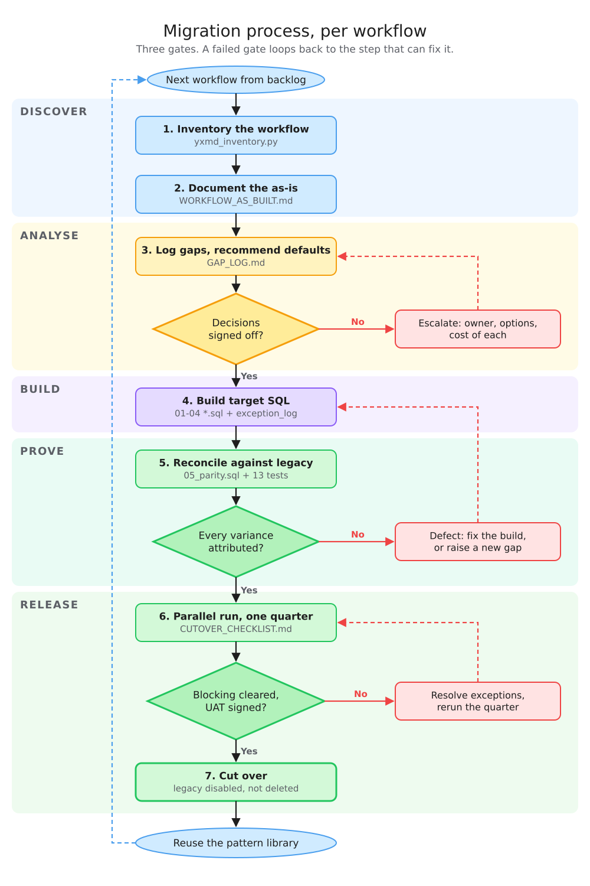

# Migrating the remaining workflows

Fee billing was workflow 1 of roughly 30. This is how the rest get sequenced,
and the argument for not doing it in the order the folder happens to list them.

## The principle

Do not estimate workflows by looking at them. A `.yxmd` is XML, so the estate
can be measured instead: `tools/yxmd_inventory.py` reads every file and reports
tool count, every formula expression, file dependencies, detected risks and a
complexity score. Running it over the whole folder produces the backlog as data,
in seconds, without opening Designer.

```bash
python3 tools/yxmd_inventory.py /path/to/workflows/ --csv backlog.csv
```

Output for workflow 1 is in `workflow_backlog.csv`. The same command over the
full estate gives the inventory the plan below is built on.

## The loop each workflow runs



## Complexity scoring

Tool count is a poor proxy for effort. What makes a migration hard is the tools
whose behaviour does not survive the move to set-based SQL:

| Weight | Tools | Why they cost |
|---|---|---|
| 8 | Macro, Run Command | Opaque. A macro is a separate file; Run Command shells out to a script nobody has read |
| 6 | Python, R | Logic in a second language, usually untested |
| 5 | Dynamic Input | Schema decided at runtime, so the contract is unknowable statically |
| 4 | Multi-Row Formula | Ordered, stateful logic. Needs window functions and careful framing |
| 2–3 | Cross Tab, Transpose, Find Replace, Join Multiple | Reshaping with semantics that differ subtly in SQL |
| 1 | Input, Output, Select, Filter, Formula, Join, Summarize, Sort | Direct equivalents |

Wave 1 is a score of 15 or under, wave 2 is 16 to 35, wave 3 is above 35. Fee
billing scored 13 on 13 tools and still hid six material defects, which is the
case for not conflating "simple" with "safe."

## Waves

**Wave 1 — simple, high-confidence (target: 12–15 workflows).** Direct tool
equivalents, one or two inputs, no macros. Migrate these first to build the
pattern library: staging conventions, the exception framework, the parity
harness. Each one after the first is faster than the last because the
scaffolding already exists.

**Wave 2 — moderate (target: 10–12).** Multi-Row Formula, Cross Tab, several
joins, or a shared dependency on another workflow's output. These need the
pattern library to exist, which is why they are not first.

**Wave 3 — complex (target: 4–6).** Macros, Run Command, Python, Dynamic Input.
Each is effectively a small project. Scope them individually after wave 1 has
calibrated the estimates.

**Separate track — retire rather than migrate.** Expect some workflows to have
no consumer. Check output paths against actual file access before spending a day
rebuilding a report nobody opens. On most estates this is 10–20% of the list and
it is the cheapest win available.

## Sequencing rules

1. **Dependencies before dependents.** The inventory reports every input and
   output path, so workflows that read another's output are visible. Migrate
   upstream first or the parity baseline moves under you.
2. **Revenue and regulatory paths get a parallel run.** Anything touching
   client invoices, regulatory reporting or the general ledger runs old and new
   side by side for a full cycle before cutover. Everything else cuts over on
   one verified reconciliation.
3. **One owner per workflow, named.** Fee billing's author left in 2023 and the
   firm lost the logic with him. Every migrated workflow lands with a named
   owner and a README, or the same thing happens again in SQL.
4. **The hard ones do not go last by default.** A wave 3 workflow that blocks a
   quarterly close is sequenced by its deadline, not its difficulty.

## What makes each one faster than the last

The reusable assets from workflow 1, already built:

- staging and dimension conventions, with key normalisation on load
- the exception framework and its reason-code taxonomy
- the parity harness, which is generic over any legacy output file
- the independent-recalculation test pattern
- the inventory and scoring script

Workflow 1 took the longest because it produced all of the above. A wave 1
workflow should land in two to three days once the pattern library exists, which
is the number to hold me to after workflows 2 and 3.

## What I would want to know before committing dates

1. The target stack. Azure SQL, Fabric, Synapse and Data Factory imply different
   orchestration and different porting work. `target/PORTING.md` lists what
   changes.
2. How parity is being proved on the migrations already done. If there is an
   existing method I should use it rather than introduce a second one.
3. Who owns the Operations spreadsheets that sit downstream of these workflows.
   Fee billing has one in its revenue path, and it is not in any inventory.
4. Whether any of the 30 are already slated for retirement.
